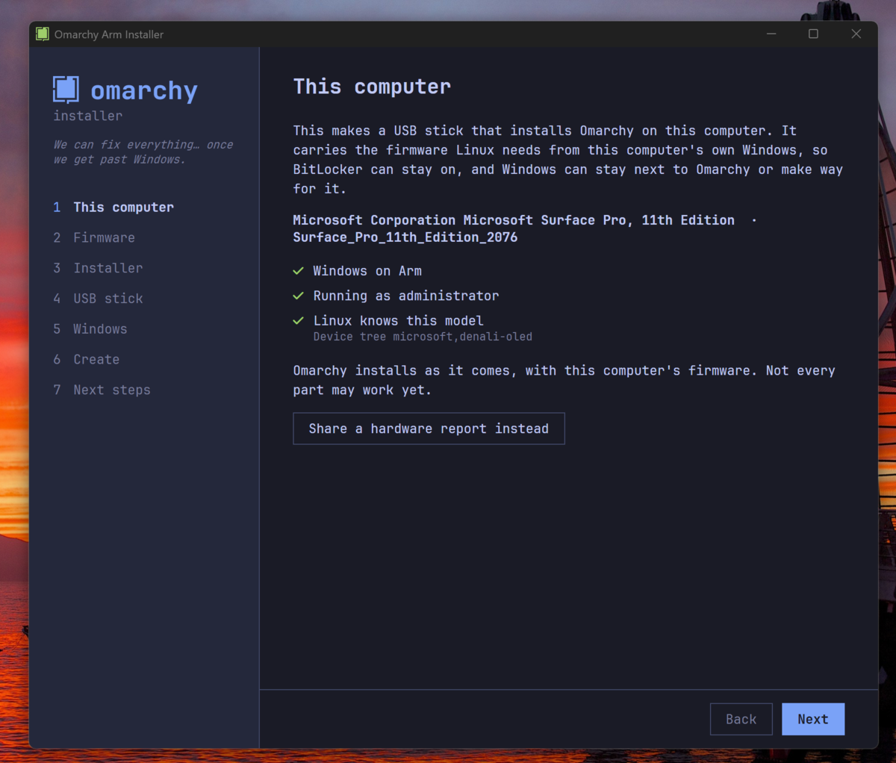
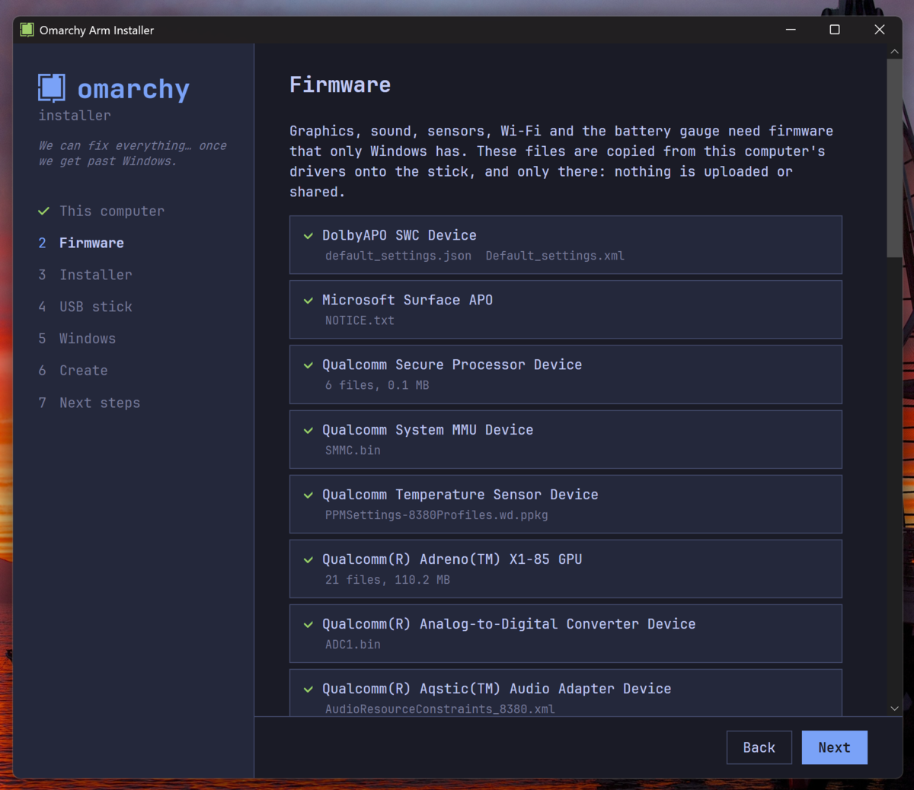
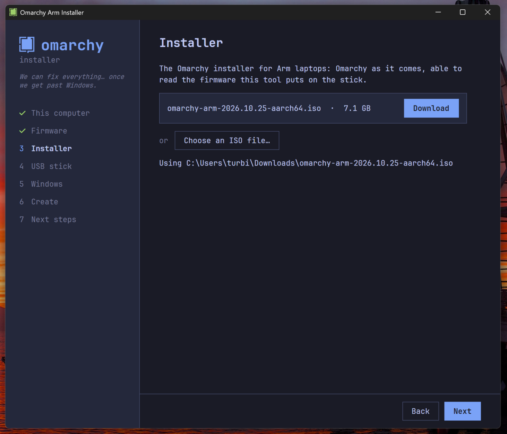
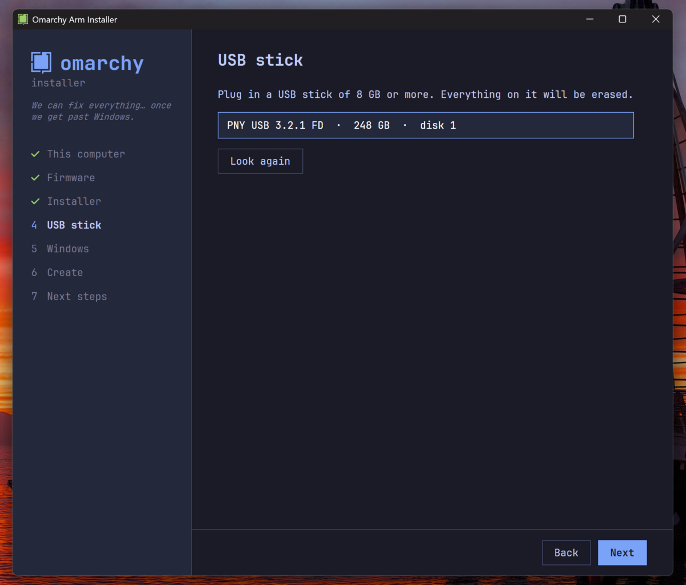
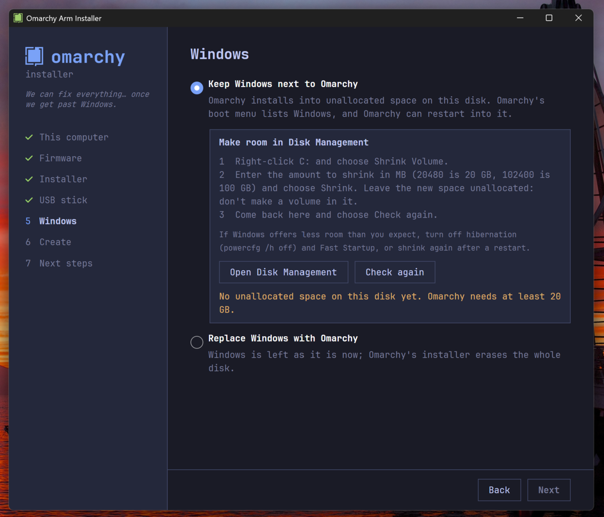
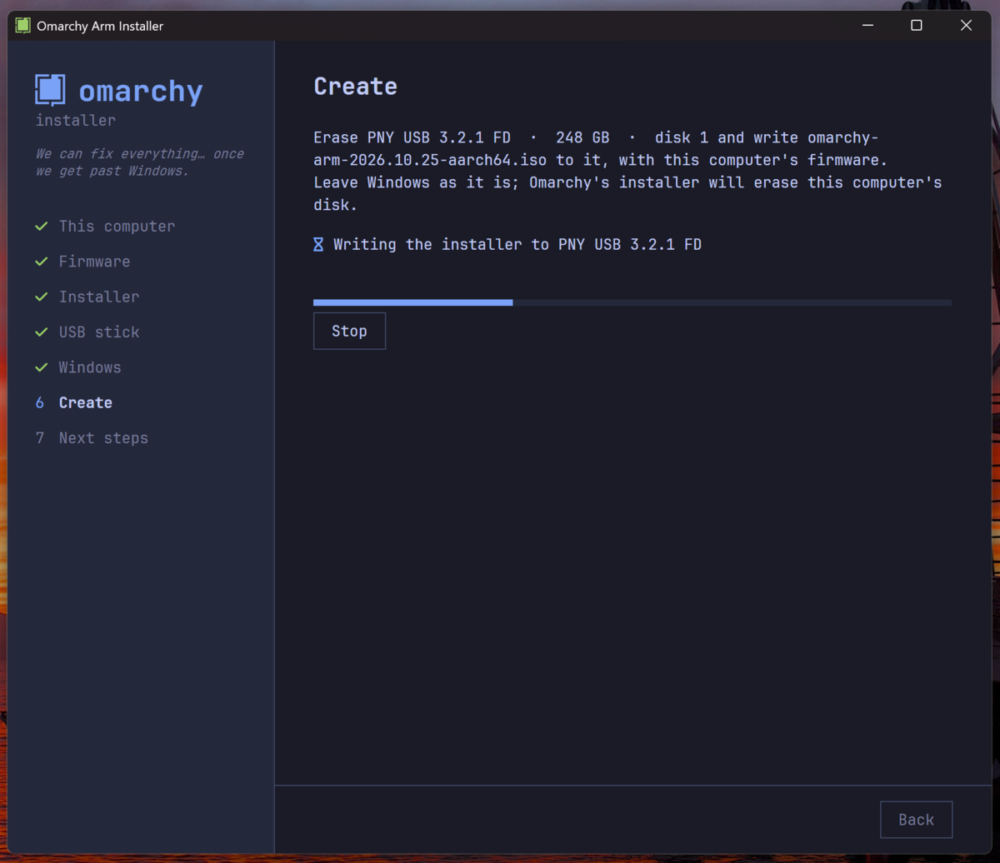
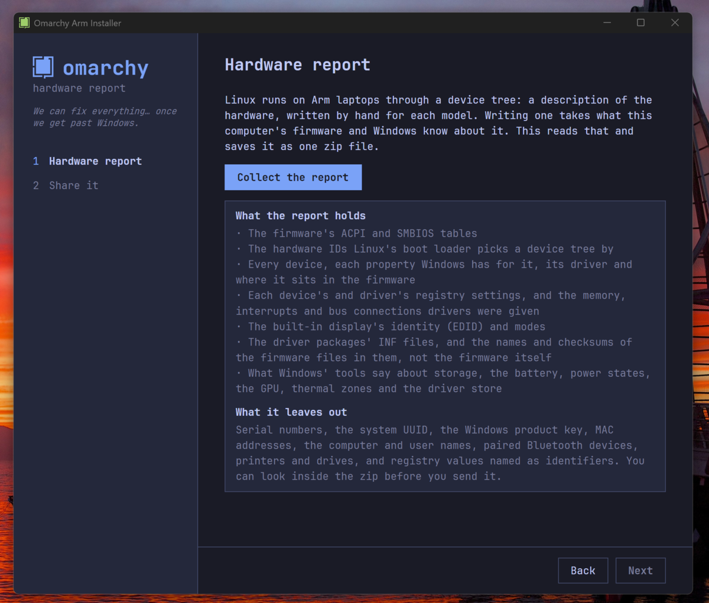
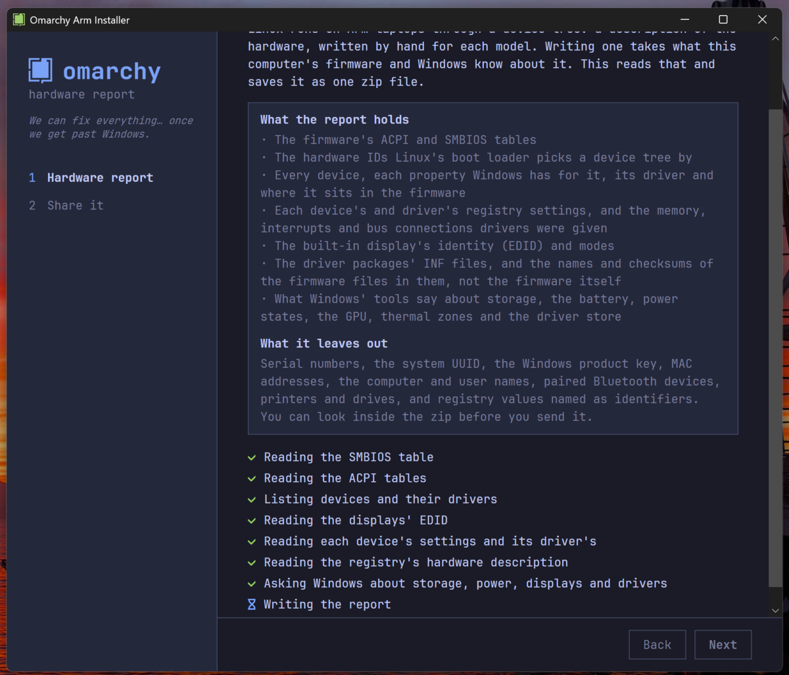
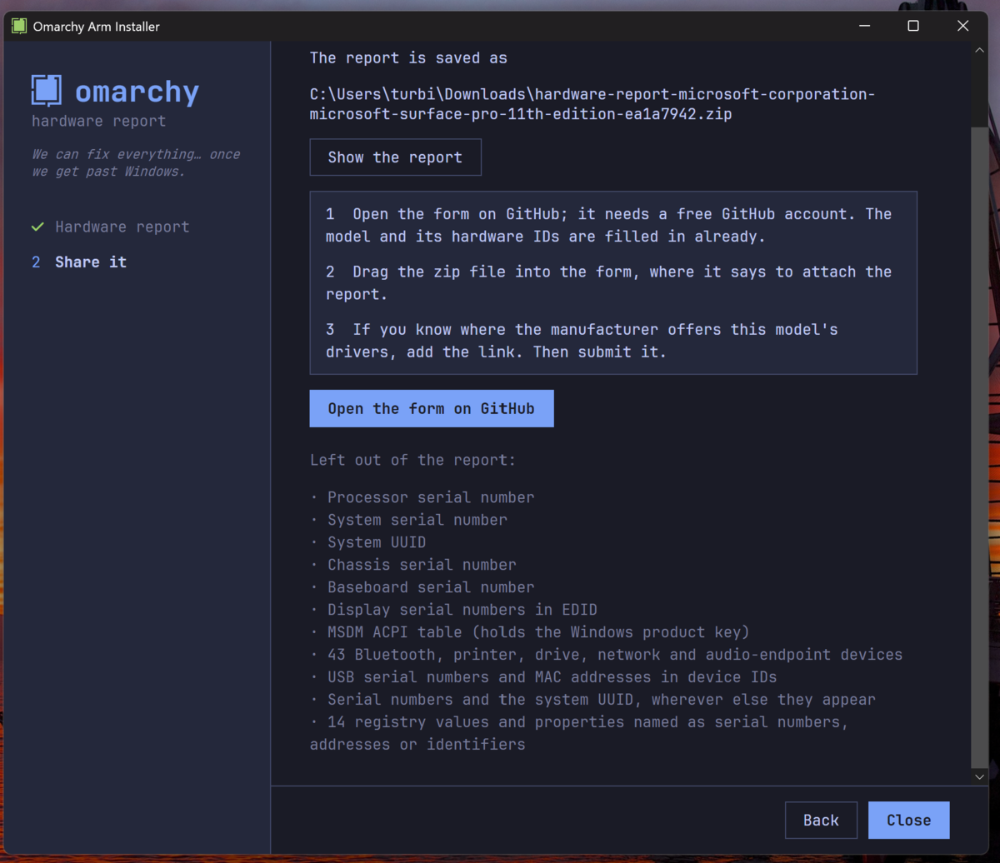

# Omarchy Arm Installer

Installs [Omarchy](https://omarchy.org) on Snapdragon laptops from their own Windows, and collects what Linux developers need to support the ones it can't yet.

Run `OmarchyArmInstaller.exe` in the laptop's Windows (as administrator). It reads the laptop first, and does one of two things:

- **Make an Omarchy USB stick**, when Linux has a device tree for the laptop. It recognises the laptop by its hardware IDs, copies the firmware Linux needs out of Windows' own drivers onto the stick, and writes the installer. BitLocker stays on: the firmware comes from the running Windows, not from its encrypted disk. Windows can stay next to Omarchy (you shrink C: in Disk Management, and the installer checks the room) or make way for it.
- **Share a hardware report**, when it doesn't: the installer says so, and what a report does and doesn't buy. The report holds everything Windows and the firmware expose about the hardware: the ACPI and SMBIOS tables, hardware IDs, every device with all its properties, each device's and driver's registry settings and the resources drivers were given, the driver packages' INF files and a list of the firmware in them, and what Windows' tools say about storage, battery, power states, displays and the driver store, saved as a zip with serial numbers and other personal details taken out, and sent to [omarchy-hardware-reports](https://github.com/turbineBMW/omarchy-hardware-reports) through an issue form.

## Making the stick

**1. This computer.** The installer checks that it's on Windows on Arm and running as administrator, names the laptop, and says whether Linux has a device tree for it. If you'd rather share a hardware report, the button is here.



**2. Firmware.** It lists the drivers whose firmware it will copy: graphics, sound, sensors, Wi-Fi, the battery gauge. The files go onto the stick and nowhere else.



**3. Installer.** Download the Omarchy image, or choose an ISO you already have.



**4. USB stick.** Pick a stick of 8 GB or more. Everything on it is erased.



**5. Windows.** Keep Windows next to Omarchy, or let Omarchy's installer take the whole disk. To keep it, shrink C: in Disk Management (the steps are on screen) and choose Check again; Omarchy needs at least 20 GB of unallocated space.



**6. Create.** The installer erases the stick and writes the image and the firmware to it. Next steps then says how to turn off Secure Boot, boot from the stick, and pick the free space or the whole disk in Omarchy's installer.



## Sharing a hardware report

**1. Hardware report.** The installer explains what a report holds and what it leaves out. Collect the report reads it all and saves one zip.





**2. Share it.** The zip is in Downloads, with a list of what was taken out of it. Open the form on GitHub (the model and its hardware IDs are filled in already), drag the zip in, add a link to the manufacturer's drivers if you know it, and submit.



## How a laptop is recognised

The installer computes the laptop's CHIDs, the hardware IDs systemd-stub picks a device tree by, from its SMBIOS table and panel EDID. Then:

| The laptop | What the installer does |
|---|---|
| Is in systemd's [hwids](https://github.com/systemd/systemd/tree/main/src/boot/hwids/aa64) (a device tree exists) | Makes the stick with Omarchy as it comes |
| Neither | Says it can't start Omarchy yet, explains the device tree, and offers the hardware report |
| Can't be read | Lets the user choose either |

`app/Assets/models.json` is systemd's list; `bin/update-models` refreshes it.

## The stick

The installer image comes from [omarchy-arm-images](https://github.com/turbineBMW/omarchy-arm-images), which builds and publishes it for this installer and the model installers alike. It is Omarchy's aarch64 ISO with patches that read a 1 GiB `OMARCHY_FW` partition on the stick, where this installer puts the firmware:

```
OMARCHY_FW/
  DriverStore/FileRepository/<package>/...   firmware, staged with qcom-firmware-extract
```

The patches are meant for omarchy-iso itself; once they are there, the stick is the stock Omarchy ISO.

## Building

```sh
dotnet publish app -c Release -r win-arm64 --self-contained true -o out   # the Windows app
sudo bin/make-usb ISO /dev/sdX --firmware .../FileRepository               # a stick from Linux
```

Off Windows the app runs as a demo that writes nothing; `OMARCHY_DEMO_DMI`, `OMARCHY_DEMO_DRIVER_STORE`, `OMARCHY_DEMO_MODE` (install or report), `OMARCHY_DEMO_STEP` (0 in the report collects it and stays) and `OMARCHY_DEMO_SCROLL=end` feed it. Logs go to `%LOCALAPPDATA%\OmarchyArmInstaller\Logs`.
